# Integrated Vector Management - Discriminating Concentration Bioassay - System Design Guide { #ento-ivm-dcb-design }

## Introduction

The Integrated Vector Management (IVM) Discriminating Concentration Bioassay toolkit supports the recording, quality control and analysis of insecticide susceptibility tests conducted on adult mosquitoes at a discriminating concentration. It digitises the bench record of a single bioassay, from the origin of the mosquitoes tested to the classification of the tested population as susceptible or resistant and makes that record available for analysis alongside the other entomological and vector control data held in the national Health Management Information System (HMIS).

This system design document outlines the key components and features of the toolkit and provides an overview of its functionality. It does not cover the resources and infrastructure needed to implement such a system, such as servers, power, internet connections, backups, training and user support, which can be found in the [DHIS2 Tracker Implementation Guide](https://docs.dhis2.org/en/implement/tracker-implementation/target-audience.html). It also does not restate the bioassay protocols themselves; the WHO standard operating procedures for the [WHO tube test](https://www.who.int/publications/i/item/9789240043831) and the [WHO bottle bioassay](https://www.who.int/publications/i/item/9789240043770), together with the [CDC bottle bioassay manual](https://www.cdc.gov/malaria/resources/pdf/fsp/ir_manual/Global-Insect-Resist-Bottle-Bioassay-508.pdf), remain the authoritative source for laboratory practice.

In the following sections of this document we describe the structure of the event program, the organisation of the data entry form, the option sets and option groups that constrain data entry, and the program rules that perform the calculations and enforce the protocol.

Reference metadata for this toolkit is available at [dhis2.org/metadata-downloads](https://dhis2.org/metadata-downloads/), and its documentation is available together with the other entomology and vector control (E&VC) modules on [docs.dhis2.org](https://docs.dhis2.org/en/topics/metadata/entomology-and-vector-control/entomology-general-design.html).

### Acknowledgements

The IVM Discriminating Concentration Bioassay toolkit for DHIS2 was designed in collaboration with the World Health Organization (WHO), which provided the technical inputs on the bioassay protocols, reviewed the coverage of the insecticide and discriminating concentration lists, and confirmed the interpretation criteria applied by the configuration.

## System design overview

### Background

Vector control is the principal means of preventing transmission of mosquitoes and several arboviral diseases. The two interventions recommended by WHO for large scale deployment against mosquito vectors, insecticide treated nets (ITNs) and indoor residual spraying (IRS), both depend on local vector populations remaining susceptible to the insecticides deployed. Widespread and increasing insecticide resistance is therefore a direct threat to the effectiveness of vector control and monitoring that resistance is a core function of any programme deploying insecticidal interventions at scale. The Global Vector Control response 2017-2030 treats strengthened entomological surveillance and the capacity to act on entomological data as foundational requirements, and integrated vector management assumes that intervention choices are informed by current, locally generated evidence on vector behaviour and susceptibility.

The standard instrument for generating that evidence is the susceptibility test at a discriminating concentration. WHO, in its [2022 manual](https://www.who.int/publications/i/item/9789240051089), defines the discriminating concentration as the concentration of an insecticide that, when a sample of mosquitoes is exposed to a treated surface for a standard period of time, reliably kills susceptible mosquitoes, so that any survivors may be assumed to be resistant. Three bioassay procedures are in routine use: the WHO tube test, the WHO bottle bioassay and the CDC bottle bioassay. They are described in the section titled Focus on key components.

Across national programmes a recurring pattern can be seen. Susceptibility data of high programmatic value are generated at considerable cost, recorded on paper forms at the bench, transcribed into spreadsheets held by individual entomologists or partners, and consolidated only when a report or a global submission requires it. The WHO framework for national insecticide resistance monitoring and management plans ([WHO, 2017](https://www.who.int/publications/i/item/9789241512138)) recommends that results be collated centrally by the national programme, reported within three months of test completion, harmonised with existing health information systems, and contributed to regional and global databases, including the global database on insecticide resistance that has accumulated monitoring data since 1978 and the Malaria Threats Map ([apps.who.int/malaria/maps/threats](https://apps.who.int/malaria/maps/threats/)) through which those data are published. Digitising the bench record at the point of capture is the most direct way to make that reporting cycle routine rather than episodic.

### Use case

The toolkit is designed for the entomological laboratory or insectary that performs discriminating concentration bioassays as part of a national or subnational resistance monitoring plan, and for the programme that uses the results. A single event corresponds to a single bioassay: one vector group, one test type, one insecticide at one discriminating concentration, one mosquito population, and one set of exposure and control replicates. The organisation unit against which the event is registered is the location from which the tested mosquitoes were collected, not the laboratory where the test was performed, so that results can be analysed geographically against the intervention and epidemiological data held elsewhere in the HMIS.

The toolkit supports the following functions:

- **Structured capture of the bench record:** the form follows the sequence of the WHO and CDC procedures, from the origin and physiological state of the mosquitoes tested, through the number of mosquitoes in each exposure and control replicate, to the counts of knocked down and dead mosquitoes at each observation time;
- **Protocol enforcement at data entry:** option groups restrict the insecticides and concentrations offered to those valid for the vector group and test type selected, and program rules assign the exposure period and the mortality endpoint implied by the product;
- **Automatic calculation of derived values:** replicate counts are totalled, mortality and knock-down rates are computed, Abbott's correction is applied where control mortality requires it, and the resistance status of the tested population is classified against the WHO thresholds;
- **Quality control at the bench:** warnings appear when control mortality or control knock-down exceeds the tolerance of the protocol and when impregnated papers or coated bottles have been stored outside the recommended temperature range; errors appear when a computed rate exceeds 100%, which indicates a transcription error in the underlying counts;
- **Provenance tracking:** an attribute category records whether the result comes from the Ministry of Health, from an implementing partner, or from a published study, so that data of differing provenance can be analysed separately or together;
- **Onward reporting:** because the variables follow the WHO recording forms, the event data can be extracted to support national reporting and submission to the WHO global database without re-entry.

The toolkit covers the discriminating concentration bioassay only. It does not cover intensity bioassays at multiples of the discriminating concentration, synergist insecticide bioassays used to investigate metabolic resistance mechanisms, molecular or biochemical assays of resistance mechanisms, or the bioefficacy and residual efficacy testing of ITNs and IRS, which are either covered by a separate module of the entomology and vector control toolkit or outside its current scope. Implementations requiring intensity or synergist assays in the same instance will need to extend the configuration locally, as no dedicated module is planned at present.

### Intended users

- **Entomologists and laboratory technicians:** the primary data capture users, who complete the form at the bench or shortly after the test, usually in an insectary or laboratory and often without reliable connectivity;
- **Entomology and vector control focal points (national and subnational):** users responsible for the resistance monitoring plan, for the quality of the results generated at sentinel sites, and for consolidating results across sites and seasons;
- **Vector control and programme managers:** data users who use susceptibility results to inform insecticide rotation, product procurement and resistance management strategies, and who need aggregate outputs rather than individual bioassay records;
- **Programme data managers:** users responsible for data quality, completeness and reporting, including submission to regional and global databases;
- **System admins/HMIS focal points:** MoH staff and/or core DHIS2 team responsible for installing the package, adapting the species and insecticide lists to the national context, maintaining the configuration over time and integrating it with the other entomological and vector control modules;
- **Implementing partners and research institutions:** users who generate susceptibility data under project or study arrangements, whose contributions are distinguished from routine Ministry of Health data through the reporting institution attribute.

### Design structure

The DHIS2 IVM Discriminating Concentration Bioassay configuration is structured as a single component, an event program, supported by the option sets, option groups and program rules that govern data entry and calculation. No dashboards, visualisations, indicators or program indicators are included in this release.

The full inventory of the metadata included in the package is available in the metadata reference file published with the package on [dhis2.org/metadata-downloads](https://dhis2.org/metadata-downloads/).

## Event program

### Event program structure

The bioassay is configured as an event program rather than a tracker program. A bioassay is a self-contained laboratory event with no longitudinal follow up of an identified entity, and the mosquito population tested is not a subject that is re-encountered. An event program also keeps the configuration simple to install and to analyse, and it is consistent with the other bioassay modules of the entomology and vector control toolkit.

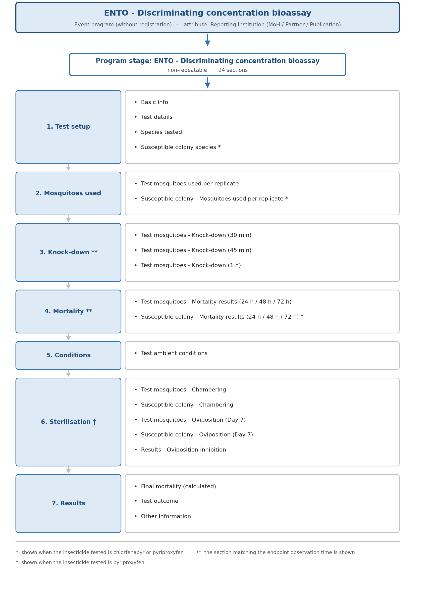

### New event registration

The creation of a new event requires the selection of a registering unit from the organisation unit hierarchy (the location where the tested mosquitoes were collected), the "ENTO - Discriminating concentration bioassay" program, and the reporting institution: MoH, Partner or Publication. The bioassay date is then entered as the event date.

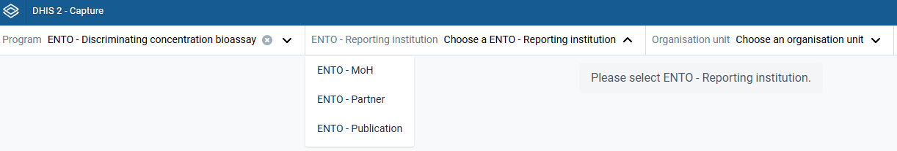

The reporting institution matters analytically because susceptibility data reaching a national programme come from three different streams with different quality assurance histories: tests conducted by the national programme or its reference laboratory, tests conducted by an implementing partner or project, and results extracted retrospectively from the published literature to fill historical gaps. Recording provenance as an attribute rather than as a data element allows results to be disaggregated by source in analytics without adding a dimension to every data element, and it follows the convention already used by the ITN bioefficacy and IRS residual efficacy modules.

The organisation unit should preferably be the collection site of the tested mosquitoes rather than the laboratory that performed the test, although this depends on what the organisation unit hierarchy of the implementation allows. Where the collection site cannot be represented in the hierarchy, the organisation unit should be chosen according to the analytical needs of the programme, since the precise location of the collection is in any case carried by the coordinates recorded in the **Basic info** section. Susceptibility status is a property of a local vector population, so analysing results against the location of a reference laboratory serving an entire country would misattribute them. Where the laboratory itself needs to be recorded, the free text data element Institute that collected data in the **Other information** section is available for that purpose.

### Basic info

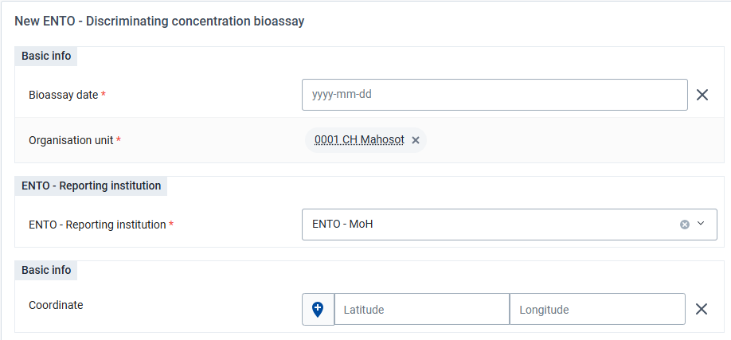

The **basic info** section captures the geographic coordinates of the collection site. The coordinates can be either written manually in the provided empty fields or selected in the map by clicking on the location icon. The organisation unit hierarchy in most implementations does not extend below the health facility or village, so the coordinate is often the only record of where the tested mosquitoes were actually collected, and completing it is recommended even though it is not enforced.

The bioassay date itself is the event date and is captured at registration rather than in this section.

### Test details

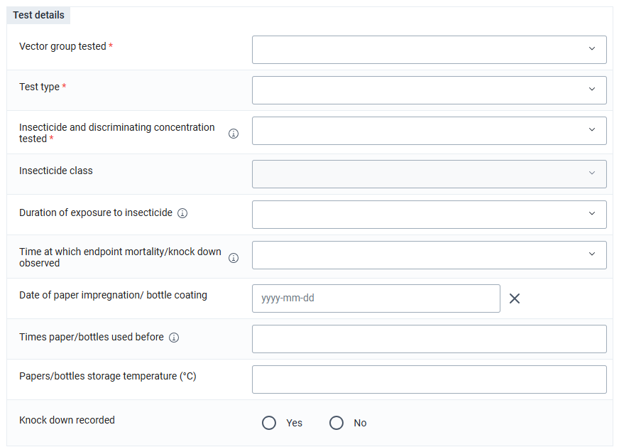

The test details section establishes the parameters of the test and drives the behaviour of the rest of the form. It captures the vector group tested (*Aedes* or *Anopheles*), the test type (WHO tube test, WHO bottle bioassay or CDC bottle bioassay), the insecticide and discriminating concentration tested, the insecticide class, the duration of exposure, the time at which the endpoint is observed, and the provenance and handling of the exposure substrate.

Three data elements are compulsory, and together they determine most of the subsequent behaviour of the form: **Vector group tested**, **Test type** and **Insecticide and discriminating concentration tested**. No other field is mandatory. A bioassay is often recorded before all observation times have elapsed, and adding mandatory fields would either block partial entry or push users to enter placeholder values.

Four of these fields are populated or constrained automatically:

- **Insecticide and discriminating concentration tested** is restricted, through option groups, to the products for which a discriminating concentration has been established for the selected vector group and test type
- **Insecticide class** is assigned by program rule from the product selected, using the ten classes in the ENTO - Insecticide class option set (butenolides, carbamates, isoxazolines, meta-diamides, neonicotinoids, organochlorines, organophosphates, pyrethroids, juvenile hormone mimics (pyriproxyfen) and pyrroles). The field is cleared when the product selection is cleared, so that a stale class is not carried into a corrected record
- **Duration of exposure to insecticide** is assigned from the test type and product, following the exposure periods of the respective procedures
- **Time at which endpoint mortality or knock-down is observed** is either assigned directly, where the product determines it, or restricted to a valid subset through an option group

The remaining fields record the handling of the exposure substrate: the date of paper impregnation or bottle coating, the number of times the paper or bottle has been used before, the storage temperature, and whether knock-down was recorded during the test. WHO specifies that insecticide impregnated papers are stored in a refrigerator at 4 °C to 8 °C in their sealed original containers, that they have a shelf life of two to five years from manufacture, and that they can be reused up to six times when stored and handled correctly. A program rule shows a warning when the recorded storage temperature falls outside the 4 °C to 8 °C range, since a substrate stored outside that range may have degraded and the resulting mortality may understate the susceptibility of the population.

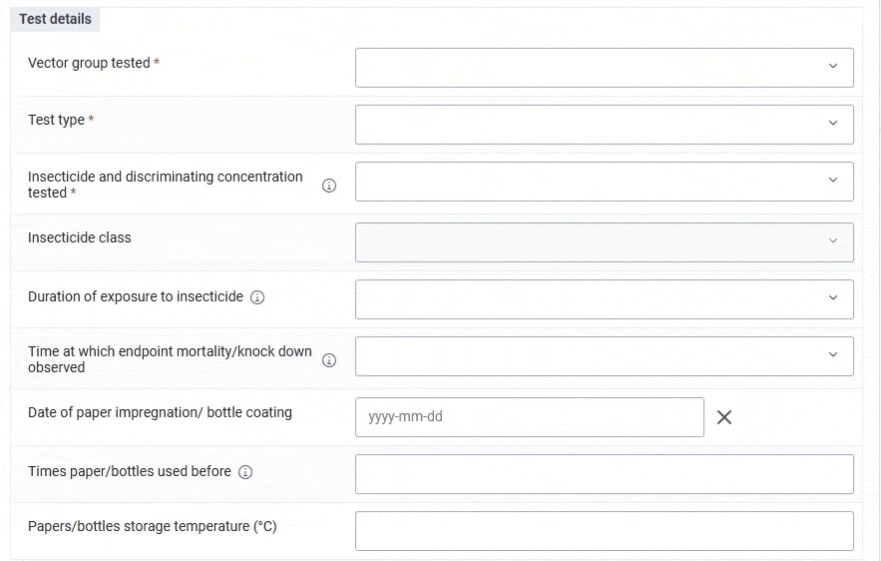

### Species tested

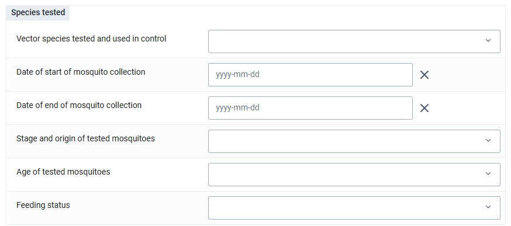

The section records what was tested and where it came from: the vector species tested and used in the control, the start and end dates of the mosquito collection, the developmental stage and origin of the tested mosquitoes, their age, and their feeding status.

These variables are not administrative detail. WHO procedures specify that tests are performed on adult female mosquitoes that are three to five days old, non-blood fed and starved of sugar for at least two hours before the test, with the exception of pyriproxyfen, where mosquitoes of five to seven days that have been blood fed one hour before exposure are used. Mosquitoes are obtained either as F0 adults reared from wild collected larvae or pupae, as F0 adults collected directly as adults, or as F1 progeny of wild caught females, and the generation used affects how the result should be interpreted. The ENTO - Stage and origin of tested mosquitoes option set lists eleven such combinations, and the ENTO - Mosquito age and ENTO - Feeding status option sets record deviations from the recommended condition explicitly rather than leaving them undocumented.

The collection dates serve a related purpose. The interval between collection and testing affects the physiological state of the mosquitoes, and recording it allows implausible records to be identified during data quality review.

The full list of the default mosquito species is available in the metadata reference file. Countries should adapt the default configuration and keep in the program only the relevant species for their context and activities.

### Susceptible colony species

A single data element records the species of the susceptible laboratory colony, drawn from the same species option set as the field population. The section is displayed only when the product tested is chlorfenapyr or pyriproxyfen, and its visibility is governed by the same rule that controls the other susceptible colony sections.

The two products are assessed against a reference colony run in parallel with the field population, so that the observed response of the field population can be judged against the response of a population known to be susceptible. For the remaining products the discriminating concentration itself provides that reference, and no parallel colony is required.

### Mosquitoes used per replicate

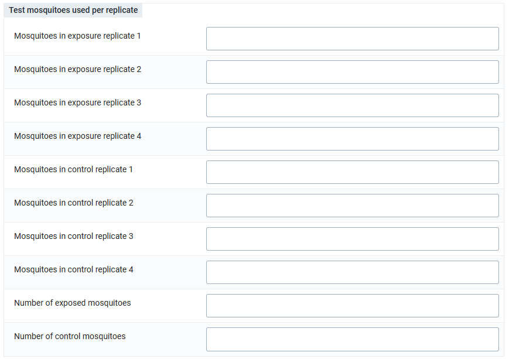

Two parallel sections record the number of mosquitoes introduced into each replicate, one for the field (wild) population and one for the susceptible colony where a colony is used. Each section provides four exposure replicates and four control replicates, together with the totals.

The totals are calculated rather than entered. A program rule sums the four exposure replicates into **Number of exposed mosquitoes** and the four control replicates into **Number of control mosquitoes**, and equivalent rules apply to the colony sections. The rules fire when any one of the four replicates has a value, so a partially completed set produces a partial total. This is intentional, since a bioassay is often recorded before all replicates have been read, but a total inspected mid entry should not be treated as final.

Recording each replicate separately rather than only the total is deliberate. The WHO procedures are built on four replicates precisely so that variability between replicates can be observed, and a total alone conceals a replicate that has failed. Keeping the replicate detail also allows the number of mosquitoes actually introduced to be recorded truthfully: the procedures specify 25 mosquitoes per replicate, but the number achieved in practice is often smaller because of losses during transfer, and the calculations in this configuration use the number recorded and not the nominal 25.

### Knock-down observations

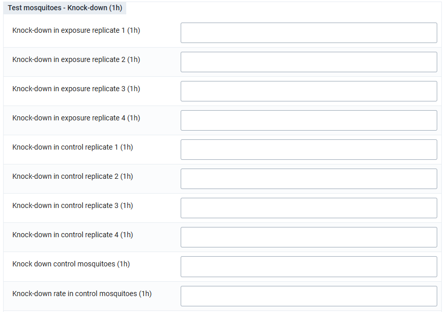

Three sections record knock-down at 30 minutes, 45 minutes and 60 minutes, each with the same structure: four exposure replicates, four control replicates, the totals for the exposed and control groups, and the corresponding rates.

Only the section matching the endpoint observation time selected in Test details is displayed, so a user recording a CDC bottle bioassay with a diagnostic time of 30 minutes sees the 30 minute section alone. Within the displayed section the totals are summed from the replicates, and the rates are calculated as the total knocked down divided by the number of mosquitoes in the corresponding group, expressed as a percentage and rounded to one decimal place.

Knock-down is the principal endpoint of the CDC bottle bioassay, where susceptibility is judged at a diagnostic time, and a secondary observation in the WHO procedures, where it is recorded at the end of the exposure period and mortality at 24 hours remains the endpoint. The configuration reflects this in its validation: the warning shown when the control knock-down rate exceeds 10% applies to CDC bottle bioassays only, because that is the procedure in which control knock-down bears directly on the validity of the result.

### Mortality results

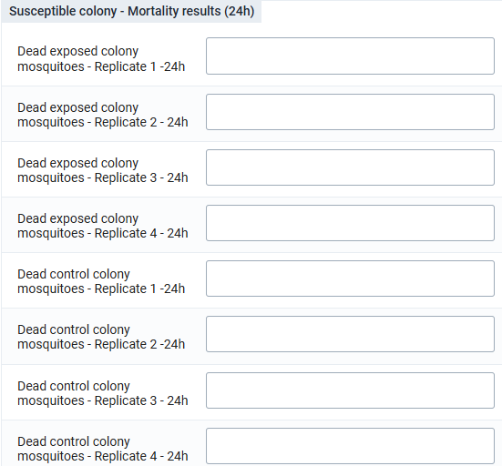

Six sections record mortality: three observation times (24 hours, 48 hours and 72 hours) for each of two populations (the field population and the susceptible colony). Each section again provides four exposure replicates, four control replicates, the two totals, and the two rates.

As with knock-down, only the sections matching the selected endpoint observation time are displayed, and the colony sections appear only where a susceptible colony is in use. The 48 hour and 72 hour observations exist because the endpoint for certain products extends beyond 24 hours: chlorfenapyr is read at 72 hours, and an intermediate reading at 48 hours is commonly recorded to document the progression of mortality.

The rates are calculated as the number dead divided by the number of mosquitoes in the group, expressed as a percentage and rounded to one decimal place.

### Test ambient conditions

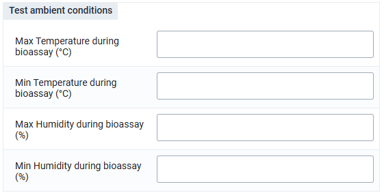

Four data elements record the maximum and minimum temperature and the maximum and minimum relative humidity observed during the bioassay. WHO procedures specify that tests are conducted at 27 °C ± 2 °C and a relative humidity of 75% ± 10%, and departures from those conditions are a recognised source of variation in observed mortality.

The configuration records the observed values without validating them against the specified ranges. Implementations that maintain a controlled insectary environment may want to add warnings at the boundaries of the specified ranges; implementations operating in field laboratories where those conditions cannot reliably be maintained are better served by recording the actual conditions and accounting for them during interpretation.

### Chambering and oviposition

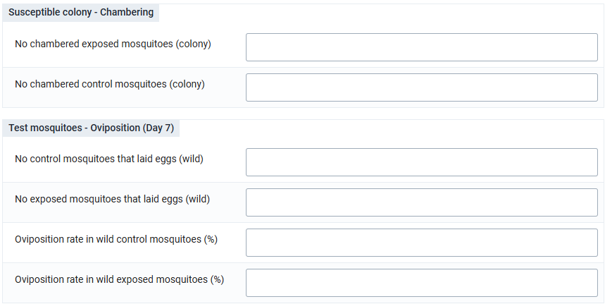

Five sections support the assessment of pyriproxyfen, an insect growth regulator whose effect is expressed as sterilisation rather than as mortality and are shown only when pyriproxyfen is the product tested. The assessment proceeds in three steps and the sections follow it:

1. **Chambering:** surviving exposed and control mosquitoes, from the field population and from the susceptible colony, are transferred to individual chambers after the holding period. Two sections record the numbers chambered
2. **Oviposition at day 7:** the number of mosquitoes that laid eggs is recorded at day 7 for each group, and the oviposition rate is calculated as the number laying eggs divided by the number chambered
3. **Oviposition inhibition:** the inhibition attributable to the insecticide is calculated for each population as (1 − oviposition rate in exposed ÷ oviposition rate in control) × 100, rounded to one decimal place, and presented in a dedicated results section

The susceptible colony is integral to this assessment rather than optional: the inhibition observed in the field population is interpreted against the inhibition observed in a population known to be susceptible, which is why the colony sections and the colony species field are displayed for pyriproxyfen and chlorfenapyr and hidden for all other products.

### Test outcome

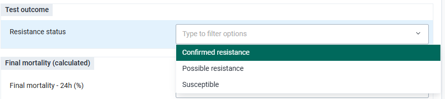

A single data element, **Resistance status**, records the classification of the tested population, drawn from an option set with three values: Confirmed resistance, Possible resistance and Susceptible. The value is assigned by program rule from the final mortality at the applicable observation time and is not entered by the user.

### Final mortality

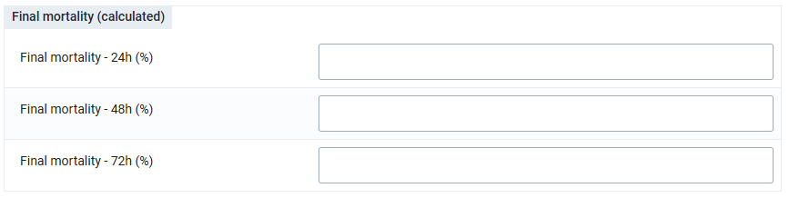

The final calculated section presents Final mortality at 24 hours, 48 hours and 72 hours: the mortality of the exposed group after correction for control mortality, as described under Mortality results. The values are assigned by program rule and are not entered by the user.

Final mortality is the number that determines the resistance status, and the number an entomologist would expect to see on the bench form and would use when comparing the result against a previous test at the same site, so it is displayed rather than held behind the scenes. An empty field here is itself informative, since it means either that the observation time in question was not part of the test or that control mortality exceeded the tolerance of the protocol and the test is invalid.

### Other information

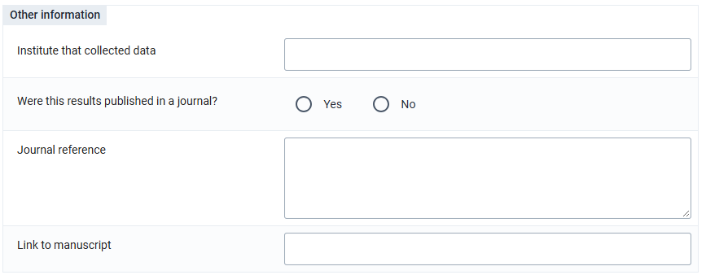

The closing section records contextual and bibliographic information: the institute that collected the data, whether the results have been published in a journal, the journal reference, and a link to the manuscript.

These fields support the retrospective digitisation of historical results, which is a common early activity when a resistance monitoring database is established. Where a result has been extracted from a published study rather than generated by the programme, the reporting institution should be set to Publication and the reference recorded here, so that the provenance of the record is unambiguous and the original source remains traceable.

## Focus on key components

The sections above follow the data entry form. This part describes the components of the configuration that cut across several of those sections: the bioassay methods the toolkit supports, the option groups that constrain the insecticide list, the correction applied to mortality, the thresholds that classify the result, and the data elements and program rules that carry the whole configuration.

### The three bioassay methods supported

The table below summarises the parameters of the three procedures that the configuration has to accommodate. The values are the standard parameters described in the WHO and CDC procedures and are given here to explain the configuration; the source documents (the [WHO tube test SOP](https://www.who.int/publications/i/item/9789240043831), the [WHO bottle bioassay SOP](https://www.who.int/publications/i/item/9789240043770) and the [CDC bottle bioassay manual](https://www.cdc.gov/malaria/resources/pdf/fsp/ir_manual/Global-Insect-Resist-Bottle-Bioassay-508.pdf)) remain authoritative.

| **Parameter**               | **WHO tube test**                                         | **WHO bottle bioassay**                                   | **CDC bottle bioassay**                                                              |
|-----------------------------|-----------------------------------------------------------|-----------------------------------------------------------|--------------------------------------------------------------------------------------|
| Exposure substrate          | Insecticide impregnated filter papers                     | Insecticide coated glass bottles                          | Insecticide coated glass bottles                                                     |
| Exposure replicates         | 4 exposure tubes                                          | 4 treated bottles                                         | 4 treated bottles                                                                    |
| Control replicates          | 2 control tubes                                           | 2 control bottles                                         | 1 control bottle                                                                     |
| Mosquitoes per replicate    | 25 (minimum 20)                                           | 25                                                        | 25 (10 to 25 in the control)                                                         |
| Exposure period             | 1 hour (2 hours for fenitrothion with *Anopheles*)        | 1 hour                                                    | Observation to the diagnostic time                                                   |
| Intermediate observation    | Knock-down at 60 minutes                                  | Knock-down at 60 minutes                                  | Knock-down or mortality at intervals up to the diagnostic time, typically 30 minutes |
| Mortality endpoint          | 24 hours, 72 hours for chlorfenapyr                       | 24 hours, 72 hours for chlorfenapyr and pyriproxyfen      | 24 hours                                                                             |
| Control mortality tolerance | Abbott's correction between 5% and 20%, discard above 20% | Abbott's correction between 5% and 20%, discard above 20% | Correction between 3% and 20%, discard above 20%                                     |
| Holding conditions          | 27 °C ± 2 °C, relative humidity 75% ± 10%                 | 27 °C ± 2 °C, relative humidity 75% ± 10%                 | 27 °C ± 2 °C, relative humidity 75% ± 10%                                            |

### Insecticide and discriminating concentration option groups

The ENTO - Insecticide concentrations option set contains 55 options, each pairing an active ingredient with a discriminating concentration expressed in the unit appropriate to the procedure: a percentage for impregnated papers, micrograms per bottle for bottle bioassays, milligrams per square metre for certain formulations. Presenting all 55 to a user who has already declared the vector group and the test type would invite selection errors, because many of the concentrations are specific to one vector group, one procedure, or both.

Five option groups are defined over that option set, and exactly one of them is shown depending on the two preceding answers:

| **Vector group** | **Test type**       | **Option group shown**                                             | **Options** |
|------------------|---------------------|--------------------------------------------------------------------|-------------|
| *Aedes*          | WHO tube test       | ENTO - Insecticide concentrations: Aedes / WHO tube test           | 12          |
| *Aedes*          | WHO bottle bioassay | ENTO - Insecticide concentrations: Aedes / WHO bottle bioassay     | 3           |
| *Anopheles*      | WHO tube test       | ENTO - Insecticide concentrations: Anopheles / WHO tube test       | 17          |
| *Anopheles*      | WHO bottle bioassay | ENTO - Insecticide concentrations: Anopheles / WHO bottle bioassay | 15          |
| Either           | CDC bottle bioassay | ENTO - Insecticide concentrations: CDC bottle bioassay             | 12          |

The same mechanism is applied to three fields in the Species tested section and to the endpoint observation time, giving fourteen option groups in total. Selecting *Aedes* restricts the species list to the five *Aedes* entries and the mosquito age, stage and origin, and feeding status lists to the values used in *Aedes* protocols. Selecting *Anopheles* restricts the species list to the 148 *Anopheles* entries and the stage, origin and feeding status lists accordingly. For the endpoint observation time, chlorfenapyr is offered the 60 minute to 72 hour range, reflecting the extended holding period required for that product, and the remaining products are offered the 60 minute to 24 hour range.

Two properties of this mechanism should be understood before adapting it. SHOWOPTIONGROUP is additive, so where two rules show two groups over the same field the user sees the union of both. And the groups constrain what is offered but do not invalidate a value already stored, so a record whose test type is changed after the product has been chosen may keep a product that the new test type would not have offered. Implementations that need stricter behaviour would have to add a validation rule or an error raising program rule for that combination.

### Control mortality and Abbott's correction

Mortality observed in the exposed group cannot be attributed to the insecticide alone, because some mosquitoes die from handling, transport or ambient conditions during the holding period. The untreated control group measures that background mortality, and WHO specifies how it is handled: below 5% no adjustment is made and the observed mortality is used as it stands, between 5% and 20% Abbott's formula is applied to correct the observed mortality for the background mortality measured in the control (the formula is given below and in the [WHO manual](https://www.who.int/publications/i/item/9789240051089)), and above 20% the test is invalid and must be discarded and repeated.

The configuration implements this as two mutually exclusive program rules per observation time, both writing to the same **Final mortality** data element:

- **Control mortality below 5%:** Final mortality is set to the observed mortality in the exposed group
- **Control mortality between 5% and 20%:** Final mortality is set to 100 × (mortality in exposed − mortality in control) ÷ (100 − mortality in control), which is Abbott's formula expressed in percentages

Where control mortality exceeds 20% neither rule executes. Final mortality is left empty and, because the resistance status classification depends on it, no resistance status is assigned either, so the invalid test produces a record that is visibly incomplete rather than a plausible but unusable result. A warning is shown on the control mortality field at each of the three observation times when it exceeds 20%, stating that the test is invalid under the WHO procedure and should be discarded and repeated, and that final mortality and resistance status are therefore not calculated.

Further warnings and errors support the same calculations. Warnings appear when mortality in the susceptible colony control reaches 20% or above at any of the three observation times, since a colony control failing at that level indicates a problem with the colony or the holding conditions rather than with the field population, and when the control knock-down rate exceeds 10% in a CDC bottle bioassay. Errors appear when any computed mortality, knock-down or oviposition rate exceeds 100%, which can only happen when the number recorded as dead or knocked down exceeds the number recorded as introduced, and therefore points to a transcription error in the underlying counts.

The threshold applied to the field population control is strictly above 20%, so that it complements the Abbott range of 5% to 20% inclusive without overlapping it, whereas the susceptible colony warnings are set at 20% or above. The two thresholds serve different purposes: the first determines whether the test is valid, the second flags a colony that is not performing as expected.

### Resistance status thresholds

Nine program rules, three for each of the three observation times, classify the tested population against the WHO interpretation scale:

| **Final mortality** | **Resistance status assigned** | **Interpretation**                                                                                                      |
|---------------------|--------------------------------|-------------------------------------------------------------------------------------------------------------------------|
| 98% or above        | Susceptible                    | The population is susceptible to the product at the discriminating concentration                                        |
| 90% to below 98%    | Possible resistance            | Resistance is suspected and the test should be repeated to confirm the result before programmatic conclusions are drawn |
| Below 90%           | Confirmed resistance\*         | The population is resistant to the product at the discriminating concentration                                          |

> **Note**
>
> \* Chlorfenapyr: under the [WHO manual (2022)](https://www.who.int/publications/i/item/9789240051089), resistance is confirmed only when three WHO bottle bioassays conducted on samples of the same vector population at different time points all show mortality below 90% 72 h after exposure, with mortality in the laboratory susceptible strain tested in parallel at the same time point being 98% or above in each test. The toolkit records the status of each individual bioassay, so this confirmation is made in analysis across the events recorded for the population. The [WHO update of 11 June 2026](https://www.who.int/news/item/11-06-2026-updates-for-insecticide-resistance-monitoring--discriminating-concentrations-and-methods) revised the criteria for confirming susceptibility to chlorfenapyr.

A given bioassay has a single endpoint observation time, so only one of the three sets of rules produces a value for any one event and the three sets are not in competition. The recorded status carries no indication of the observation time at which it was determined, so analyses that combine results across products with different endpoints should read Resistance status together with Time at which endpoint mortality or knock-down is observed rather than in isolation.

Two points matter during interpretation. The Possible resistance band is a call for confirmation and not a finding: WHO is explicit that a result in the 90% to 97% band should be repeated, and the toolkit records the status of the individual bioassay and not the conclusion of a confirmed sequence of bioassays. And the [WHO update of 11 June 2026](https://www.who.int/news/item/11-06-2026-updates-for-insecticide-resistance-monitoring--discriminating-concentrations-and-methods) clarifies the criteria for confirming susceptibility to chlorfenapyr specifically, so implementations testing chlorfenapyr should check that the interpretation applied locally reflects the current guidance for that product.

### Data elements

All 172 data elements configured for this program are also included in the data element group:

- ENTO - IVM Discriminating concentration bioassay \[ENTOdcbDEG1\]

This serves as a de facto DHIS2 data dictionary for the discriminating concentration bioassay use case. It allows the data elements to be exported from DHIS2 and used independently of the event program configuration, for example in the case that an implementation redesigns the form for local workflows and still wants to maintain alignment with the WHO recording variables.

The full list of data elements, with codes, value types and option set assignments, is available in the metadata reference file. Two conventions in that list are worth noting:

- **Captured against calculated:** data elements of value type INTEGER_ZERO_OR_POSITIVE are generally captured by the user, and those of value type NUMBER expressing a percentage are generally calculated by program rule. Implementations that remove or replace a program rule should check that the corresponding calculated data element is either populated by another means or hidden from the form
- **Replicate numbering:** replicate data elements are numbered one to four in both the exposure and control arms, and in both the field and colony populations. The naming and the codes are parallel across observation times, which makes the set straightforward to extend should a fifth replicate be required locally

Some of the DEs in this program could be shared with other E&VC programs, in particular those describing the mosquito population and the ambient conditions. They are configured as program specific data elements in this release, and an implementation running several entomological modules in the same instance may want to consolidate them.

### Program rules

The configuration relies on program rules rather than on program indicators. Mortality rates, corrected mortality and resistance status are properties of the individual bioassay that the entomologist needs to see at the bench, not aggregate measures derived after the fact. Calculating them at data entry also guides the user through the protocol and removes the complexity of maintaining a large number of program indicators.

The 123 program rules are organised into five priority tiers, which the DHIS2 rule engine evaluates in ascending order. The tiering matters because the outputs of one tier are the inputs of the next:

| **Priority** | **Purpose**                                                                                                                                | **Examples**                                                                                                                                                            |
|--------------|--------------------------------------------------------------------------------------------------------------------------------------------|-------------------------------------------------------------------------------------------------------------------------------------------------------------------------|
| 1            | Totals from replicates, assignment of protocol constants, option group visibility, section visibility for product dependent blocks         | Sum of exposure and control replicates; assignment of the endpoint observation time; display of the insecticide concentration group matching vector group and test type |
| 2            | Rates derived from the totals, assignment of the insecticide class and exposure duration, section visibility for endpoint dependent blocks | Mortality and knock-down rates in the exposed and control groups; display of the mortality section matching the selected endpoint                                       |
| 3            | Validation of the calculated rates                                                                                                         | Errors where a rate exceeds 100%; warnings on control mortality above 20%, on colony control mortality at or above 20%, and on control knock-down above 10%             |
| 4            | Correction of mortality for control mortality, oviposition inhibition                                                                      | Abbott's correction where control mortality is between 5% and 20%; uncorrected assignment where it is below 5%                                                          |
| 5            | Classification of the tested population                                                                                                    | Assignment of Resistance status from final mortality against the WHO thresholds                                                                                         |

The 140 program rule actions break down as 72 assignments performing the calculations and protocol constants, 21 section hiding actions and 14 option group actions shaping the form to the test being recorded, and 24 errors and 9 warnings enforcing the protocol and the arithmetic. The full list of PRs is available in the metadata reference file.

Two behaviours of the rule engine are relevant to anyone adapting these rules. Assignment rules overwrite the target data element whenever their condition is met, so a value entered manually into a calculated field is replaced on the next evaluation. And section hiding rules are expressed negatively in this configuration, hiding a section when its precondition is not met, which means that a section with no governing rule is visible by default.

## User Groups

| **User group**          | **Metadata**      | **Data**             |
|-------------------------|-------------------|----------------------|
| ENTO IVM - Admin        | Can edit and view | No access            |
| ENTO IVM - Access       | Can view only     | Can view only        |
| ENTO IVM - Data capture | Can view only     | Can capture and view |

The separation of metadata editing from data access is the point of the arrangement: the administrator group maintains the configuration without gaining access to the data, the data capture group records bioassays without being able to alter the configuration on which the calculations depend, and the access group consumes results without being able to change either. Entomologists and laboratory technicians who complete the form are assigned to the data capture group, programme and vector control managers who use the results to the access group, and the HMIS or core DHIS2 team responsible for the configuration to the administration group.

Where an implementation distinguishes between laboratories, or between the national programme and implementing partners, additional user groups can be created and combined with organisation unit assignment and sharing to restrict visibility. Such groups should be added locally rather than substituted for the three standard groups, which the packaging and upgrade process relies upon.

## Implementation Considerations & Local Adaptation

This chapter describes some of the possibilities for adapting the configuration for local context and needs, as well as implementation considerations that are relevant for the discriminating concentration bioassay use case.

### Adapting the vector species list

The ENTO - Vector species tested/controlled option set contains 151 species, comprising the *Anopheles* and *Aedes* species of recognised or potential vectorial importance worldwide. No national programme tests more than a small fraction of them.

Reducing the list to the species actually present and tested in the country is the single most valuable adaptation available and is recommended before the toolkit is put into routine use. A list of 151 options presented on a mobile device is slow to navigate and invites mis-selection between similarly named members of a species complex. Where the taxonomic resolution available locally does not allow identification to species, the complex level entries in the list should be kept in preference to recording a species that has not been confirmed.

Two constraints apply when the list is reduced. Options still referenced by stored event data should be retained rather than deleted, since removing them orphans the data values that carry their codes. And the two option groups over this option set, one for *Aedes* and one for *Anopheles*, must be trimmed in step with the option set, since it is the groups and not the option set that determine what the user is offered.

The list can also be extended, so that the toolkit follows changes in the vectors present in the country, such as the detection of an invasive species, and in their taxonomy. Adding a species of a genus already covered takes four steps:

- **Check the existing list:** confirm that the species is not already in the ENTO - Vector species tested/controlled option set, including under a complex level entry or a former name.
- **Add the option:** create the species as a new option in the option set, with the scientific name as the option name and a code following the existing convention, the genus prefix (AN\_ for *Anopheles*, AE\_ for *Aedes*) followed by the species name in upper case, using only letters, digits and underscores.
- **Add it to the option group:** add the new option to the option group of its genus, since the groups and not the option set determine what the user is offered.
- **Check the discriminating concentrations:** where WHO or CDC has established a discriminating concentration for the procedure used on the new species, make sure the corresponding entry is present in the ENTO - Insecticide concentrations option set and its option groups, as described in the next section.

Adding a genus not yet covered, such as *Culex*, is a larger change: it needs a new option in the vector group field, new option groups for the species list and for the other fields that depend on the vector group, and new program rules to show those groups. Implementations that extend the lists are encouraged to share the additions through the [DHIS2 Community of Practice](https://community.dhis2.org/), so that they can be considered for inclusion in the core package and the module evolves with the needs of national programmes.

### Adapting the insecticide and discriminating concentration list

The 55 entries in the ENTO - Insecticide concentrations option set correspond to the products and concentrations for which WHO or CDC has established a discriminating concentration for the procedures supported. As with the species list, most programmes test a small subset, determined by the products deployed nationally and by the products under consideration for future deployment.

The list should be reduced to that subset and the five option groups trimmed correspondingly. The option groups and not the option set govern what the user sees, and an option removed from the option set but left in a group, or the reverse, produces inconsistent behaviour in the form.

The insecticide class assignment rules should be reviewed at the same time. Each of the ten class assignment rules names the products belonging to its class explicitly in its condition, so a product added locally will not receive a class until it is added to the relevant rule. The same applies to the rules that assign the exposure duration and the endpoint observation time.

### Keeping up-to-date with WHO updates to discriminating concentrations

Discriminating concentrations are periodically added and revised as new active ingredients enter vector control and as multi-centre studies refine existing values. WHO published such an update in June 2026 ([WHO, 11 June 2026](https://www.who.int/news/item/11-06-2026-updates-for-insecticide-resistance-monitoring--discriminating-concentrations-and-methods)), establishing discriminating concentrations in WHO bottle bioassays for broflanilide and isocycloseram: for *Aedes aegypti*, broflanilide at 10 µg per bottle and isocycloseram at 15 µg per bottle, in acetone with MERO at 1500 ppm; and for *Anopheles*, broflanilide at 10, 15 and 25 µg per bottle and isocycloseram at 30, 60 and 50 µg per bottle for *An. gambiae*, *An. funestus* and *An. stephensi* respectively, in acetone with MERO at 800 ppm.

The option set in this release includes the three broflanilide and three isocycloseram concentrations in the *Anopheles* WHO bottle bioassay group. Implementations testing either product against *Aedes aegypti* will need to add the corresponding concentrations locally and should expect to repeat that exercise as further updates are issued.

Two implications follow. The concentration list is the component of this package with the shortest half-life, and its maintenance should be treated as a recurring task rather than a one-off configuration step. And because the discriminating concentration is recorded as a single option combining the active ingredient with its concentration, a revision to a concentration produces a new option rather than a modification of an existing one; the superseded option should be kept for historical data and removed from the option group so that it is no longer offered for new tests.

### Reporting institution and data provenance

The attribute category ENTO - Reporting institution offers three values, and implementations should decide how they are used early on, because the choice is difficult to revise once data have accumulated.

The convention assumed by the design is that MoH denotes tests conducted by the national programme or its reference laboratory, Partner denotes tests conducted by an implementing partner or project, and Publication denotes results transcribed from published literature. Implementations that need finer provenance, for example distinguishing between named partners, can extend the category options, at the cost of a wider attribute dimension in analytics. Implementations that do not need the distinction at all can restrict data entry to a single option rather than removing the category, since the category combination is referenced by the program.

The free text data element **Institute that collected data** in the **Other information** section overlaps intentionally with this attribute. The design intention is that the attribute carries the analytical dimension and the data element carries the specific institution name for reference, and implementations should confirm that convention in their data entry guidance so that the two do not diverge.

### Positioning within the entomology and vector control toolkit

The toolkit is one component of the wider DHIS2 entomology and vector control offering, which includes modules for ITN mass campaigns and ITN bioefficacy testing, IRS campaigns and IRS residual efficacy testing, breeding site mapping and monitoring, and adult mosquito surveillance. The discriminating concentration bioassay module addresses insecticide resistance monitoring, which the vector control unit of the WHO Department of Malaria and Neglected Tropical Diseases lists among the areas covered by its DHIS2 data collection and collation tools ([WHO vector control: DHIS2 tools](https://www.who.int/teams/global-malaria-programme/prevention/vector-control/dhis-data-collection-and-collation-tools)).

Implementations installing several of these modules in the same instance should consider two points of intersection. The first is shared metadata: the species list, the ambient condition variables and the reporting institution attribute recur across modules, and consolidating them reduces maintenance and improves the consistency of analysis, at the cost of coupling the modules together so that a change made for one affects the others. Most implementations share the species option set and the reporting institution attribute, which are genuinely common, and leave the measurement data elements module specific.

The second is the analytical relationship between the modules. Susceptibility results become most useful when read against the products deployed and their measured bioefficacy in the same geography, since a fall in observed bioefficacy may reflect either the decay of the insecticide on the substrate or the resistance of the local population, and only the combination of the two data sources distinguishes them. Implementations that intend to support that analysis should make sure the organisation unit hierarchy and the geographic granularity of collection sites are consistent across the modules.

### Data collection VS system maturity

The bioassay record is generated in an insectary or laboratory and completed over a period of hours to days as the observation times elapse. Two options are practical and implementations commonly use both:

**Option 1: Direct entry in the laboratory**

Where the laboratory has a computer and connectivity, the entomologist enters the record directly in the DHIS2 web Capture app, returning to the event as each observation time is read. This is the preferred option where it is feasible, because it removes a transcription step and because the calculated fields and warnings are available at the bench, where they can prompt a correction while the test is still in progress.

**Option 2: Offline entry on a mobile device**

Where connectivity is intermittent, the DHIS2 Android Capture app supports offline data entry with synchronisation when connectivity is restored. The section form and the program rules operate offline, so the calculations and warnings remain available. Coordinate capture is more convenient on a mobile device, and the species and concentration lists should be reduced before deployment, since long option lists are markedly less usable on a small screen.

In both cases, keeping the paper bench form as the primary record during the test itself and entering the data into DHIS2 on completion remains a legitimate arrangement and is often the realistic starting point. The objective is that the digital record becomes the authoritative one over time, not that paper is eliminated on day one.

### Onward reporting

The WHO framework for national insecticide resistance monitoring and management plans recommends that results be collated centrally by the national programme, reported within three months of test completion, and contributed to regional and global databases. Because the variables in this configuration follow the WHO recording forms, an event export from this program provides most of what such a submission requires, and implementations are encouraged to define the export once and reuse it rather than reconstructing it for each reporting round.

Susceptibility data also feed national decision making directly. WHO recommends that vector susceptibility to all insecticide classes in use or under consideration be tested at least once a year at sentinel sites, that the sites be selected on the basis of endemicity, insecticide usage, vector abundance and accessibility, and that a national decision making body review resistance data alongside intervention quality and epidemiological information when adjusting vector control strategy. A configuration that makes the results available promptly and in a consistent form is a precondition for that review, not a substitute for it.

## References

WHO. Manual for monitoring insecticide resistance in mosquito vectors and selecting appropriate interventions. Geneva: World Health Organization; 2022. Available at: <https://www.who.int/publications/i/item/9789240051089>

WHO. Standard operating procedure for testing insecticide susceptibility of adult mosquitoes in WHO tube tests. 2nd ed. Geneva: World Health Organization; 2022. Available at: <https://www.who.int/publications/i/item/9789240043831>

WHO. Standard operating procedure for testing insecticide susceptibility of adult mosquitoes in WHO bottle bioassays. 2nd ed. Geneva: World Health Organization; 2022. Available at: <https://www.who.int/publications/i/item/9789240043770>

WHO. Determining discriminating concentrations of insecticides for monitoring resistance in mosquitoes: report of a multi-centre laboratory study and WHO expert consultations. Geneva: World Health Organization; 2022. Available at: <https://www.who.int/publications/i/item/9789240045200>

WHO. Updates for insecticide resistance monitoring: discriminating concentrations and methods. 11 June 2026. Available at: <https://www.who.int/news/item/11-06-2026-updates-for-insecticide-resistance-monitoring--discriminating-concentrations-and-methods>

WHO. Monitoring and managing insecticide resistance in Aedes mosquito populations: interim guidance for entomologists. Geneva: World Health Organization; 2016. Available at: <https://www.who.int/publications/i/item/WHO-ZIKV-VC-16.1>

WHO. Framework for a national plan for monitoring and management of insecticide resistance in malaria vectors. Geneva: World Health Organization; 2017. Available at: <https://www.who.int/publications/i/item/9789241512138>

WHO. Global vector control response 2017-2030. Geneva: World Health Organization; 2017. Available at: <https://www.who.int/publications/i/item/9789241512978>

WHO Global Malaria Programme. Insecticide resistance. Available at: <https://www.who.int/teams/global-malaria-programme/prevention/vector-control/insecticide-resistance>

WHO Global Malaria Programme. DHIS2 data collection and collation tools for vector control. Available at: <https://www.who.int/teams/global-malaria-programme/prevention/vector-control/dhis-data-collection-and-collation-tools>

WHO. Malaria Threats Map. Available at: <https://apps.who.int/malaria/maps/threats/>

US Centers for Disease Control and Prevention. Global manual for evaluating insecticide resistance using the CDC bottle bioassay. Available at: <https://www.cdc.gov/malaria/resources/pdf/fsp/ir_manual/Global-Insect-Resist-Bottle-Bioassay-508.pdf>

DHIS2. Tracker Implementation Guide. Available at: <https://docs.dhis2.org/en/implement/tracker-implementation/target-audience.html>

